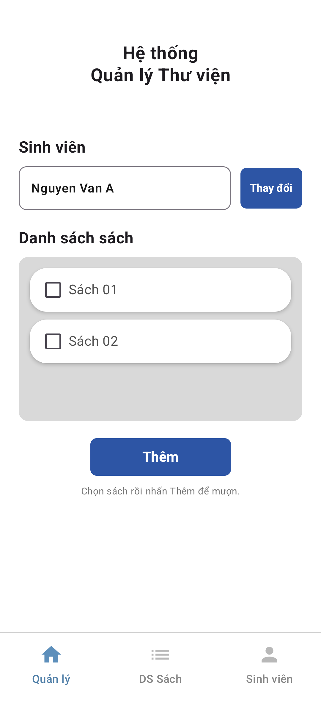
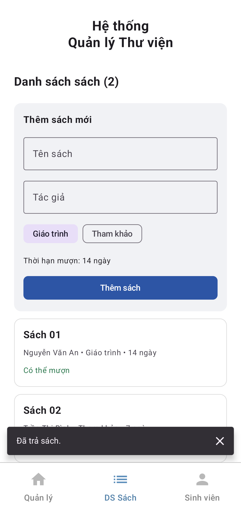
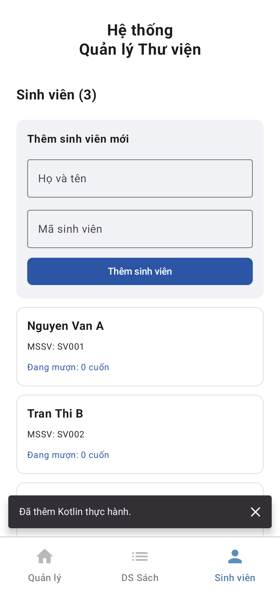

# Hệ thống Quản lý Thư viện — Bài tập tuần 4

Ứng dụng **Kotlin + Jetpack Compose**, gồm **3 trang**: **Quản lý**, **DS Sách**, **Sinh viên**.

## Mở và chạy bằng Android Studio

1. Chọn **File → Open**, mở chính thư mục `quản lý thư viện` (thư mục chứa `settings.gradle.kts`).
2. Chọn **Gradle JDK 17 hoặc 21** trong **Settings → Build, Execution, Deployment → Build Tools → Gradle**. Máy hiện tại đã được cấu hình cục bộ dùng `C:\Users\Acer\.jdks\jbr-21.0.11`. Không dùng JDK 25 với Gradle 8.10.2.
3. Chờ **Sync Project with Gradle Files**. Cần Internet nếu máy chưa có các thư viện.
4. Chọn module **app**, máy ảo/điện thoại Android **7.0 (API 24)** trở lên, nhấn **Run ▶**.

Phiên bản: AGP 8.7.3, Gradle 8.10.2, Kotlin/Compose Compiler 2.0.21, Compose BOM 2024.12.01, compile/target SDK 35. `local.properties` chứa SDK của máy hiện tại và được bỏ qua khi đưa lên Git.

Build và kiểm thử bằng PowerShell tại thư mục dự án:

```powershell
$env:JAVA_HOME = "$env:USERPROFILE\.jdks\jbr-21.0.11"
.\gradlew.bat :app:assembleDebug :app:testDebugUnitTest :app:lintDebug
# Sau khi mở máy ảo Android:
.\gradlew.bat :app:connectedDebugAndroidTest
```

APK được tạo tại `app/build/outputs/apk/debug/app-debug.apk`.

## Chức năng của 3 trang

### 1. Quản lý

- Tiêu đề, ô sinh viên, nút **Thay đổi**, danh sách checkbox và nút **Thêm** bố trí theo ảnh đề bài.
- **Thay đổi** mở danh sách sinh viên để chọn người mượn.
- Chọn một hoặc nhiều cuốn sách rồi nhấn **Thêm** để ghi nhận mượn cho sinh viên đó.
- Sách đã được mượn sẽ khóa checkbox. Nếu sinh viên hiện tại là người mượn, hiển thị dấu chọn và hạn trả; nếu người khác mượn, hiển thị **Đã có người mượn**.
- Phần **Sách đang mượn** cho phép **Trả sách**; sau khi trả, sách lại có thể được mượn.

### 2. DS Sách

- Tạo sách với tên, tác giả và loại **Giáo trình** hoặc **Tham khảo**.
- Hiển thị thông tin, thời hạn mượn, tình trạng sẵn có, người đang mượn và hạn trả.
- Mỗi bản ghi tương ứng **một bản sách vật lý**. Có thể thêm hai bản sách cùng tên, mỗi bản có ID riêng.

### 3. Sinh viên

- Tạo sinh viên với họ tên và mã sinh viên.
- Mã sinh viên không được trùng, không phân biệt chữ hoa/thường và bỏ khoảng trắng đầu/cuối.
- Hiển thị số sách đang mượn cùng tên sách và hạn trả của từng sinh viên.

Lần đầu chạy có 2 sách và 3 sinh viên mẫu. Chưa có lượt mượn; checkbox ban đầu để trống để sinh viên tự chọn. Tất cả thay đổi hợp lệ được lưu dưới dạng JSON trong SharedPreferences riêng của ứng dụng. Đóng/mở ứng dụng hoặc xoay màn hình không mất dữ liệu. Xóa dữ liệu ứng dụng hoặc gỡ cài đặt sẽ xóa dữ liệu đã nhập.

## Đầy đủ 4 đặc trưng OOP

| Đặc trưng | Vị trí | Cách thể hiện |
|---|---|---|
| Đóng gói | `domain/LibraryManager.kt` | `books`, `students`, `loans` đều `private`. Chỉ thao tác qua `addBook`, `addStudent`, `borrow`, `returnBook`. `snapshot()` trả bản sao danh sách; thuộc tính model dùng `val`. |
| Trừu tượng | `domain/Models.kt` | `abstract class Book` định nghĩa `typeName()`, `loanDays()`, `typeKey()`. Không thể tạo đối tượng `Book` trực tiếp. |
| Kế thừa | `domain/Models.kt` | `Textbook` và `ReferenceBook` kế thừa `Book`, dùng chung `id`, `title`, `author`, `information()`. |
| Đa hình | `LibraryManager.borrow()` và trang DS Sách | Các đối tượng được lưu dưới kiểu `Book`. Gọi `book.loanDays()` tự chọn hành vi: giáo trình 14 ngày, tham khảo 7 ngày. Kết quả thực sự được dùng để tính `Loan.dueAt`, không chỉ là ví dụ in ra màn hình. |

Ví dụ giải thích khi trình bày:

```kotlin
val books: List<Book> = listOf(
    Textbook("1", "Lập trình Kotlin", "Tác giả A"),
    ReferenceBook("2", "Tra cứu Android", "Tác giả B"),
)
books.forEach { book ->
    println("${book.title}: ${book.loanDays()} ngày")
}
// Cùng một lời gọi loanDays(): đối tượng đầu trả 14, đối tượng sau trả 7.
```

## Yêu cầu nullable cho toàn bộ thuộc tính class

**Tất cả thuộc tính do dự án khai báo trong class đều có kiểu nullable (`?`)**, gồm model, danh sách private của `LibraryManager`, `SharedPreferences?` của `LibraryStore`, trạng thái của `LibraryViewModel` và thuộc tính rule trong kiểm thử giao diện.

```kotlin
abstract class Book(
    val id: String? = null,
    val title: String? = null,
    val author: String? = null,
)

private var books: MutableList<Book>? = null
var state: LibrarySnapshot? by mutableStateOf(null)
    private set
```

- `MutableList<Book>?` nghĩa là **bản thân danh sách có thể null**; phần tử của danh sách là đối tượng `Book` hợp lệ.
- Dùng `?.`, `?:`, `orEmpty()`, `isNullOrBlank()` để xử lý null. Không dùng toán tử `!!` trong mã ứng dụng.
- Nullable không có nghĩa chấp nhận dữ liệu nhập rỗng: nghiệp vụ vẫn kiểm tra bắt buộc họ tên, mã sinh viên, tên sách và tác giả.
- Biến cục bộ trong hàm Compose, tham số hàm, kiểu trả về và các thuộc tính có sẵn của Android/Jetpack không phải thuộc tính class do bài tập khai báo. Chúng không cần bị đổi thành nullable.
- Tham số constructor không có `val`/`var` (ví dụ `context: Context`) chỉ là tham số, không phải thuộc tính.

## Cấu trúc mã nguồn

```text
app/src/main/java/com/example/quanlythuvien/
├── MainActivity.kt             # Activity khởi chạy
├── domain/
│   ├── Models.kt               # Book, Textbook, ReferenceBook, Student, Loan
│   └── LibraryManager.kt       # Quy tắc thêm, mượn, trả + dữ liệu mẫu
├── data/
│   └── LibraryStore.kt         # Đọc/ghi JSON và SharedPreferences
└── ui/
    ├── LibraryViewModel.kt     # Trạng thái quan sát được, lưu dữ liệu ngoài main thread
    └── LibraryApp.kt           # 3 trang Compose và thanh điều hướng
```

`ViewModel` chỉ công bố trạng thái mới sau khi lưu thành công. Nếu ghi thất bại, trạng thái đang hiển thị được giữ nguyên và có thông báo. Nếu đọc dữ liệu lỗi, ứng dụng cho phép thử lại, không tự ghi đè dữ liệu cũ bằng dữ liệu mẫu.

## Kiểm thử

Kết quả đã chạy trên máy hiện tại ngày **26/10/2026**:

- Build APK: **thành công**.
- Unit test: **11/11 đạt**, không bỏ qua bài kiểm thử nào.
- Kiểm thử thiết bị trên **Medium Phone, Android 15 (API 35)**: **2/2 đạt**.
- Android Lint: **0 lỗi**; còn các cảnh báo không chặn build về phiên bản thư viện, cấu hình backup và kiểu collection của trạng thái lựa chọn (mã luôn gán danh sách mới khi thay đổi).

- `LibraryManagerTest`: nullable, tính hạn trả theo đa hình, chặn mượn trùng, tính toàn vẹn khi mượn nhiều sách, kiểm tra ID, trả đúng người, mã sinh viên trùng, kiểm tra dữ liệu đầu vào, đóng gói danh sách và khôi phục trạng thái.
- `LibraryAppTest`: chuyển 3 tab, mượn/trả sách, chọn sinh viên, thêm sách/sinh viên, tạo lại Activity và lưu/đọc JSON với thuộc tính null.
- Báo cáo JVM: `app/build/reports/tests/testDebugUnitTest/index.html`.
- Báo cáo Lint: `app/build/reports/lint-results-debug.html`.
- Báo cáo thiết bị: `app/build/reports/androidTests/connected/debug/index.html`.

## Ảnh chạy thực tế trên máy ảo

| Quản lý | DS Sách | Sinh viên |
|---|---|---|
|  |  |  |

Ảnh thứ hai và thứ ba có thông báo kết quả thao tác vì được chụp trong chuỗi kiểm thử thực tế. Biểu mẫu/danh sách có thể cuộn khi nội dung dài hoặc màn hình nhỏ.

